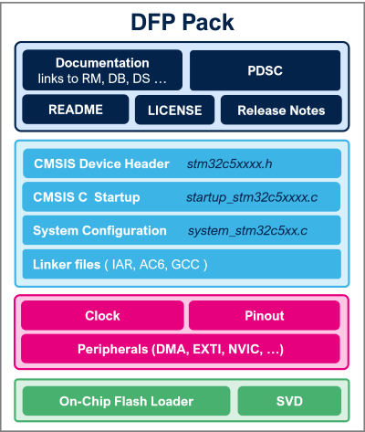

# Release Notes for
# <mark>STM32C5xx DFP Software Pack</mark>

# Purpose

STM32Cube enables developers to achieve design success. With a comprehensive suite of professional development tools and embedded software components, STM32Cube allows developers to differentiate products, streamline design cycles, and reduce costs. STM32Cube ecosystem supports all design steps, including selection, configuration, development, debugging, programming, and monitoring.

The STM32Cube embedded software offer provides ready-to-use software components that can be added to a project. It includes STM32 peripheral driver APIs with two levels of abstraction, middleware, board drivers, and examples. There are several distribution channels, including the STM32CubeMX2 tool, the ST website, and GitHub. All embedded software comes with enhanced online documentation, with flowcharts and user sequences.

More detailed documentation is available at [STM32C5xx DFP online documentation](https://dev.st.com/stm32cube-docs/stm32c5xx-dfp/latest/en/index.html).

# **Update History**

<label for="collapse-v-2-0-0" aria-hidden="true">**2.0.0 /  13-March-2026**</label>

## First Official release of STM32C5xx DFP

### Supported Devices

- STM32C551xx, STM32C552xx, STM32C562xx devices
- STM32C531xx, STM32C532xx, STM32C542xx devices
- STM32C591xx, STM32C593xx, STM32C5A3xx devices

## Contents

### CMSIS-Core Device Files

- Device C Startup files
- Device system configuration files
- Device header and System View Description (SVD) files, supporting
  - **System** : CORTEX, CRS, DBGMCU, DMA, EXTI, FLASH, GPIO, ICACHE, IWDG, PWR, RAMCFG, RCC, SBS, WWDG
  - **Analog** : ADC, COMP, DAC, OPAMP
  - **Timers** : LPTIM, RTC, TIM
  - **Connectivity** : ETH, FDCAN, I2C, I3C, SMARTCARD, SMBUS, SPI, UART, LPUART, USART, USB, XSPI(DLYB)
  - **Security** : AES, HASH, RNG, PKA, CCB, TAMP
  - **Computing** : CORDIC, CRC
- Device linker configuration template files

### Integrated Development Environment and Tools Support Files

- Flash Programming Algorithms for erasing and downloading code into on-chip Flash
- System View Description (SVD) files
- Device descriptor files for bus, clock, peripherals and pinout

## Supported Integrated Development Environment and Compilers

- IAR Embedded Workbench for ARM (EWARM) toolchain V9.60.3 + ST-LINK (Patch available in `IDEs_patches/EWARM`)
- MDK-ARM Keil uVision V5.42
- STM32CubeIDE for Visual Studio Code (GCC13 compiler)

## Known Limitations

- None

## Dependencies

- CMSIS Core V6.3.0

<footer class="sticky">
For complete documentation on STM32 Microcontrollers </mark> ,
visit: http://www.st.com/stm32
</footer>